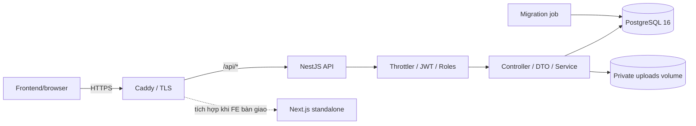
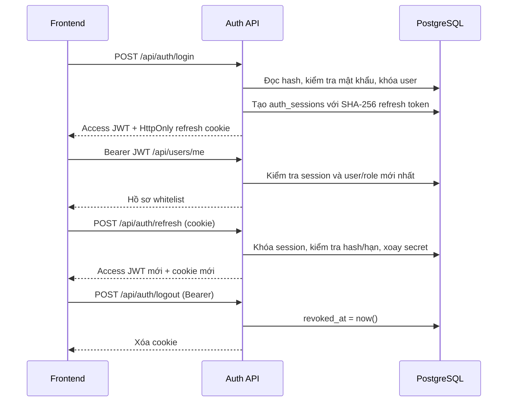
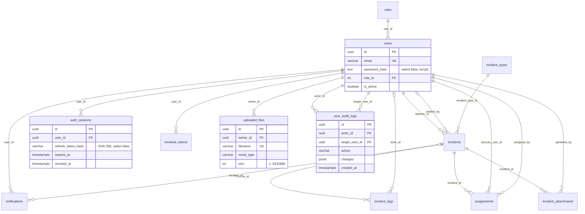

# Kiến trúc SafeOps

Modular Monolith NestJS/TypeScript, PostgreSQL 17 cho dev hiện có, PostgreSQL 16 cho deployment mới, TypeORM migration. Auth, Users, Incidents, Assignments, IncidentLogs, Notifications, Dashboard, Gateway là 8 module nghiệp vụ. UploadsModule tách riêng việc nhận và đọc ảnh; IncidentTypesModule và AttachmentsModule giữ API nghiệp vụ đầy đủ của dự án hiện tại. AuthSession, UserAuditLog, UploadedFile là ba bảng hỗ trợ mới, ngoài 8 bảng nghiệp vụ và RevokedToken hiện có. Xem [INTEGRATION](INTEGRATION.md) cho trạng thái triển khai và [README](../README.md) cho lệnh chạy.

Caddy là cổng duy nhất của production. Backend/PostgreSQL không publish port ra host. Backend tin đúng một proxy và chỉ nhận traffic qua mạng container. Dev publish PostgreSQL, pgAdmin, Mailhog trên loopback. API chạy user `node`, filesystem read-only ngoại trừ upload volume và `/tmp`; không copy `.env` vào image. Log truy vấn tắt mặc định.

Guard chạy trước interceptor và pipe theo vòng đời NestJS. Thứ tự bảo vệ: Throttler → JwtAuthGuard → RolesGuard → validation tham số → controller/service → serialize/response wrapper. Filter trả lỗi thống nhất. `@Public()` bỏ JWT/RBAC nhưng vẫn giữ throttling; route được bảo vệ mà thiếu `@Roles` bị từ chối. `ClassSerializerInterceptor`, `User.passwordHash select:false` và presenter whitelist bảo vệ dữ liệu trả ra.

## ERD

8 bảng nghiệp vụ hiện hữu và 4 bảng kỹ thuật: `revoked_tokens` (di sản logout cũ), `auth_sessions`, `user_audit_logs`, `uploaded_files`. Session mới được thu hồi qua `auth_sessions`, không cần lưu mọi JWT vào revoked_tokens.

Migration `1794300000000-Be1Foundation` đổi MANAGER → OPERATOR, giữ ID nếu chưa có OPERATOR, chuyển tham chiếu user trước khi xóa role cũ nếu có cả hai. Tạo 4 role nếu thiếu. Chuẩn hóa email, thêm unique index trên `lower(trim(email))`. Nếu dữ liệu cũ có email trùng sau chuẩn hóa, migration dừng và rollback thay vì tự gộp người dùng. Không bật synchronize ở production.

Tạo user nội bộ, thay role/trạng thái và audit chạy cùng transaction; khóa advisory tuần tự hóa thay đổi quản trị, đọc lại quyền của Admin trong transaction. Admin không được tự khóa hoặc tự thay role của mình. Password/email đổi sẽ thu hồi mọi phiên trong cùng transaction. Refresh dùng row lock nên hai request cùng cookie chỉ một request xoay thành công.

Mỗi request được bảo vệ đọc lại session và user/role từ DB; chưa có cache để tránh trì hoãn khóa tài khoản. Throttler hiện dùng bộ nhớ một instance. Khi chạy nhiều replica, thay storage bằng bộ đếm dùng chung và dùng object storage/chung volume cho upload; đây là bước mở rộng, cấu hình production hiện chạy một backend.
