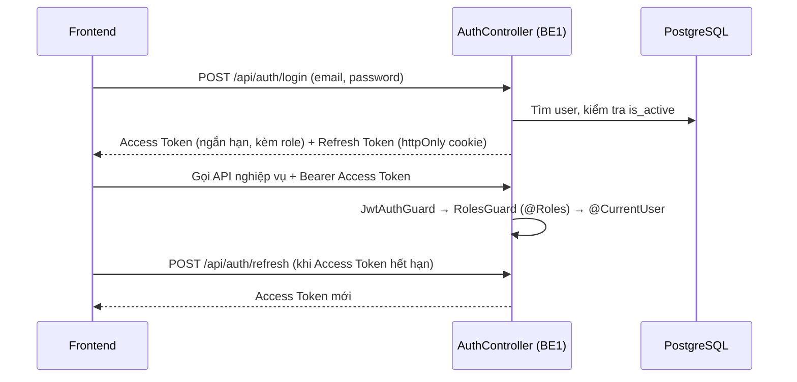

# SafeOps — Tài liệu luồng công việc & yêu cầu vị trí BE1

| Thông tin | Chi tiết |
|---|---|
| **Dự án** | SafeOps — Hệ thống tiếp nhận, điều phối & xử lý sự cố an ninh doanh nghiệp |
| **Vị trí** | **BE1 — Backend Lead (Core NestJS, Auth/RBAC, Users, Upload, Admin, Docker/CI/CD)** |
| **Thời gian** | 16 tuần / 8 Sprint · 06/11/2026 → 25/02/2027 (đã trừ nghỉ Tết 05/02–09/02/2027) |
| **Nguồn** | Bảng phân chia task dự án SafeOps (sheet *Tasks*, cập nhật 06/11/2026) |
| **Dẫn dắt** | BE2, BE3 (về kiến trúc, chuẩn code, review) |
| **Phối hợp chính** | FE1 (FE Lead) · BE2 (CSDL & sự cố) · BE3 (Real-time, Dashboard, kiểm thử API) |

---

## 1. Tổng quan vai trò

BE1 là **trưởng nhóm Backend, chịu trách nhiệm nền tảng kỹ thuật và an toàn của toàn hệ thống**: khung dự án NestJS, xác thực – phân quyền, quản lý người dùng, bảo mật upload, hạ tầng Docker/CI/CD và đóng gói triển khai. Mọi API của BE2, BE3 đều chạy trên khung và các Guard do BE1 xây dựng.

**Trách nhiệm chính**

1. **Nền móng & hạ tầng**: đặc tả API, Docker Compose, biến môi trường, GitHub Actions CI, khởi tạo dự án NestJS 8 module.
2. **Xác thực & phân quyền (Auth/RBAC)**: bcrypt, JWT Access + Refresh Token, Guard theo 4 vai trò, chống dò mật khẩu.
3. **Quản lý người dùng**: hồ sơ cá nhân, danh sách người dùng, quản trị tài khoản cho Admin.
4. **Upload an toàn**: kiểm tra định dạng thật của file, giới hạn dung lượng, lưu trữ.
5. **Chất lượng, bảo mật & triển khai**: Unit Test, rà soát bảo mật (OWASP/IDOR), Dockerfile production + HTTPS, tài liệu kỹ thuật & Swagger.
6. **Vai trò Lead**: reviewer bắt buộc của Pull Request (cùng FE1), chốt chuẩn kiến trúc, gỡ blocker cho BE2, BE3.

**Quy mô công việc:** 18 task (17 task trong phạm vi 16 tuần + 1 task giai đoạn 2) · tổng ước tính **22 ngày công** (20.5 ngày công trong phạm vi nghiệm thu, không gồm M9).

| Ưu tiên | Số task | Ý nghĩa |
|---|---|---|
| **P0** | 16 | Bắt buộc cho bản nghiệm thu chính thức |
| **P1** | 1 | Hoàn thiện chuẩn doanh nghiệp (M0-13: CI) |
| **P2** | 1 | Giai đoạn 2 — tạm hoãn (M9-02: SSO) |

> **Lưu ý khối lượng:** ngoài 22 ngày công của task, BE1 còn gánh việc **review mọi PR** của 5 thành viên (FE1 chia sẻ). Cần dành thời gian review cố định mỗi ngày, đặc biệt ở các sprint đông PR (M2, M3, M4).

---

## 2. Luồng công việc tổng thể

```
M0 Khung dự án, Docker, CI, đặc tả API ──► M1 Auth + RBAC + Users ──► M2 Upload
                                                                          │
   M8 Docker prod, Tài liệu ◄── M7 Unit Test, Bảo mật ◄── M6 Admin Users ◄┘
                              (M3–M5: Lead hỗ trợ, review PR, gỡ blocker)
```

| Giai đoạn | Thời gian | Trọng tâm của BE1 | Ngày công |
|---|---|---|---|
| **M0** — Khảo sát, thiết kế & nền móng | 06/11 – 19/11/2026 | Đặc tả API, Docker Compose, `.env`, CI, khởi tạo NestJS | 5.0 |
| **M1** — CSDL, Xác thực & Phân quyền | 20/11 – 03/12/2026 | bcrypt + JWT, API Auth, Guard RBAC, API Users | 7.0 |
| **M2** — Tiếp nhận, Upload & Quản lý sự cố | 04/12 – 17/12/2026 | `UploadService` an toàn, `POST /api/uploads` | 1.5 |
| **M3** — Xác minh, Điều phối & Security | 18/12 – 31/12/2026 | *(không có task riêng — review PR, hỗ trợ BE2/BE3)* | — |
| **M4** — Bản đồ & Real-time | 01/01 – 14/01/2027 | *(không có task riêng — hỗ trợ BE3 xác thực JWT cho Socket.IO)* | — |
| **M5** — Thông báo, Dashboard, Export | 15/01 – 28/01/2027 | *(không có task riêng — review, chuẩn bị M6)* | — |
| **M6** — Admin, Tìm kiếm & PWA | 29/01 – 12/02/2027 | API quản trị người dùng | 1.5 |
| **M7** — Kiểm thử, Hiệu năng & Bảo mật | 13/02 – 18/02/2027 | Unit Test (Jest); rà soát bảo mật | 3.0 |
| **M8** — Triển khai, Tài liệu & Nghiệm thu | 19/02 – 25/02/2027 | Dockerfile multi-stage + HTTPS; tài liệu kỹ thuật | 2.5 |
| **M9** — Giai đoạn 2 *(tạm hoãn)* | Sau nghiệm thu | SSO doanh nghiệp (OAuth2 / Entra ID / Google) | 1.5 |

> **Khoảng trống M3–M5** là chủ ý của phân bổ: BE1 giữ năng lực cho vai trò Lead (review, tích hợp, xử lý sự cố) khi BE2, BE3 đang ở cao điểm. Nên chủ động dùng thời gian này để hoàn thiện Swagger, rà soát Guard/RBAC trên API mới và chuẩn bị trước cho M7–M8.

### 2.1 Luồng xác thực & phân quyền (BE1 là chủ sở hữu)



- **4 vai trò:** Admin · Operator · Security · Reporter — kiểm tra quyền **ở tầng Backend cho mọi API**, không tin vào Frontend.
- Mọi response **không** được chứa `password_hash`.

### 2.2 Luồng dữ liệu — sự phụ thuộc giữa BE1 và các thành viên khác

**BE1 cần đầu vào từ (upstream):**

| Task nguồn | Người làm | Nội dung | BE1 dùng cho |
|---|---|---|---|
| M0-02 | Cả nhóm | Chốt kiến trúc Modular Monolith & bộ công nghệ | M0-06 |
| M0-05 | BE2 | ERD 8 bảng | M0-06 |
| M0-10 | FE1 | Khởi tạo repo, cấu trúc thư mục, ESLint, Prettier | M0-11, M0-13, M0-14 |
| M1-02 | BE2 | Entity `Role`, `User` | M1-07 |
| M6-04 | BE3 | API phân tích hiệu suất | M7-01 |
| M7-06 | BE2 | Tối ưu truy vấn & sửa lỗi BE | M8-01 |
| M7-07 | FE1 | Sửa lỗi giao diện, UX | M8-01 |

**Các thành viên khác phụ thuộc vào BE1 (downstream):**

| Task BE1 | Bàn giao cho | Ghi chú |
|---|---|---|
| M0-06 (đặc tả API) | Toàn bộ BE & FE | Hợp đồng API + sự kiện Socket.IO — nền tảng tích hợp |
| M0-11 (Docker Compose) | BE2 — M0-15 | Môi trường Postgres dùng chung |
| M0-14 (khung NestJS) | BE2 — M0-15 · BE3 — M0-16 | **Nút thắt đầu dự án** |
| M1-08 (API Auth) | FE1 — M1-15 | Trang đăng nhập / đăng ký |
| M1-10 (Guard RBAC) | BE3 — M4-01 · BE1 — M1-11, M1-12, M2-02 | Mọi API có phân quyền đều cần Guard |
| M1-11 (Users/me) | FE3 — M1-17 | Trang hồ sơ cá nhân |
| M1-12 (danh sách Users) | BE3 — M1-18 · FE2 — M3-08 | Operator lấy danh sách Security để phân công |
| M2-02 (Upload) | BE2 — M2-03 | **Nút thắt M2**: tạo sự cố kèm ảnh |
| M6-01 (Admin Users) | FE3 — M6-05 | Trang quản trị người dùng |
| M7-01 (Unit Test) | BE2 — M7-02 · BE1 — M7-05 | Chuỗi kiểm thử cuối |
| M8-01 (Dockerfile) | BE2 — M8-02 · BE1 — M8-05 · Cả nhóm — M8-04 | Không có bản deploy thì không có UAT |

> **Nguyên tắc bàn giao:** ngay khi API merge vào `develop`, cập nhật Swagger và báo FE/BE liên quan. API chưa có Swagger = chưa tính là hoàn thành.

---

## 3. Chi tiết nhiệm vụ & yêu cầu theo milestone

> Định dạng mỗi task: **ID — Tên task** · ưu tiên · ước tính · thời gian · phụ thuộc → **Tiêu chí hoàn thành**.

### M0 — Nền móng (5.0 ngày công)

| ID | Task | Ưu tiên | Ngày công | Thời gian | Phụ thuộc |
|---|---|---|---|---|---|
| **M0-06** | Thiết kế đặc tả REST API (`/api/*`), chuẩn mã lỗi & hợp đồng sự kiện Socket.IO | P0 | 1.5 | 09/11 – 11/11 | M0-02, M0-05 |
| **M0-11** | `docker-compose.yml` môi trường dev (PostgreSQL 16, pgAdmin, Mailhog) | P0 | 1.0 | 12/11 – 13/11 | M0-10 |
| **M0-12** | `.env.example` & module kiểm tra biến môi trường (Joi/Zod) | P0 | 0.5 | 13/11 – 14/11 | M0-11 |
| **M0-13** | GitHub Actions CI (build, lint, test cho mỗi PR) | P1 | 1.0 | 14/11 – 16/11 | M0-10 |
| **M0-14** | Khởi tạo dự án NestJS + TypeScript + 8 module nghiệp vụ | P0 | 1.0 | 13/11 – 15/11 | M0-10 |

**Yêu cầu**
- **M0-06:** đặc tả chi tiết request/response, phân trang, lọc, chuẩn mã lỗi và danh sách event WebSocket giữa BE & FE; **chốt cùng BE2, BE3** trước khi các bên bắt đầu code.
- **M0-11:** container `postgres:16` có volume và healthcheck; khởi động toàn bộ môi trường bằng một lệnh `docker compose up -d`; dùng chung cho 6 thành viên.
- **M0-12:** `.env.example` đủ biến DB, JWT, Upload, Mail, `NEXT_PUBLIC_API_URL`, `NEXT_PUBLIC_WS_URL`; ứng dụng **báo lỗi ngay khi khởi động** nếu thiếu biến.
- **M0-13:** CI kiểm tra biên dịch TypeScript cho cả NestJS và Next.js, lint và test mỗi khi tạo PR; là điều kiện merge bắt buộc.
- **M0-14:** cấu trúc sẵn `AuthModule`, `UsersModule`, `IncidentsModule`, `AssignmentsModule`, `IncidentLogsModule`, `NotificationsModule`, `DashboardModule`, `GatewayModule`.

### M1 — Xác thực, Phân quyền & Người dùng (7.0 ngày công)

| ID | Task | Ưu tiên | Ngày công | Thời gian | Phụ thuộc |
|---|---|---|---|---|---|
| **M1-07** | Dịch vụ bcrypt & quản lý JWT (Access + Refresh Token) | P0 | 1.5 | 20/11 – 23/11 | M1-02 |
| **M1-08** | `POST /api/auth/register`, `/login`, `/logout` | P0 | 1.5 | 23/11 – 25/11 | M1-07 |
| **M1-09** | `POST /api/auth/refresh` & giới hạn đăng nhập sai (Throttler) | P0 | 1.0 | 25/11 – 26/11 | M1-08 |
| **M1-10** | `JwtAuthGuard`, `RolesGuard`, decorator `@Roles()`, `@CurrentUser()` | P0 | 1.0 | 27/11 – 28/11 | M1-08 |
| **M1-11** | `GET/PATCH /api/users/me` & `PATCH /api/users/me/password` | P0 | 1.0 | 28/11 – 30/11 | M1-10 |
| **M1-12** | `GET /api/users` (phân trang, lọc theo role/trạng thái) | P0 | 1.0 | 30/11 – 01/12 | M1-10 |

**Yêu cầu**
- **M1-07:** Access Token **ngắn hạn** kèm thông tin role; Refresh Token lưu **httpOnly cookie**; mật khẩu băm bằng bcrypt, không lưu/trả mật khẩu gốc.
- **M1-08:** trùng email trả `409`; tài khoản `is_active = false` bị từ chối đăng nhập; **ẩn `password_hash` trong mọi response**.
- **M1-09:** cấp Access Token mới từ Refresh Token hợp lệ; dùng Throttler giới hạn đăng nhập sai để chống dò mật khẩu.
- **M1-10:** kiểm tra chặt quyền Admin, Operator, Security, Reporter ở tầng Backend cho mọi API; áp dụng được bằng decorator gọn gàng để BE2, BE3 tái sử dụng. **Task này là cổng của hầu hết API còn lại — ưu tiên hoàn thành đúng hạn.**
- **M1-11:** xem/cập nhật họ tên, số điện thoại; đổi mật khẩu có kiểm tra mật khẩu hiện tại.
- **M1-12:** Admin & Operator xem danh sách; Operator lấy được danh sách nhân viên **Security đang hoạt động** để phục vụ phân công sự cố.

### M2 — Upload (1.5 ngày công)

| ID | Task | Ưu tiên | Ngày công | Thời gian | Phụ thuộc |
|---|---|---|---|---|---|
| **M2-02** | `UploadService` & `POST /api/uploads` (nhiều hình ảnh) | P0 | 1.5 | 05/12 – 08/12 | M1-10 |

**Yêu cầu:** kiểm tra định dạng **thực tế bằng magic bytes** (JPG/PNG/WEBP), không tin đuôi file hay `Content-Type`; giới hạn ≤ **5MB/ảnh**; trả về danh sách URL; đặt tên file ngẫu nhiên, chống path traversal; chỉ người dùng đã xác thực mới được tải lên. BE1 phụ trách bảo mật upload & lưu trữ. *Phải xong 08/12 để BE2 làm M2-03.*

### M6 — Quản trị người dùng (1.5 ngày công)

| ID | Task | Ưu tiên | Ngày công | Thời gian | Phụ thuộc |
|---|---|---|---|---|---|
| **M6-01** | API quản trị người dùng cho Admin | P0 | 1.5 | 29/01 – 01/02 | M1-12 |

**Yêu cầu:** Admin tạo tài khoản nội bộ (Operator/Security), đổi `role_id`, khóa/mở khóa (vô hiệu hóa) tài khoản vi phạm; chỉ Admin truy cập được; ghi nhận thay đổi quyền để truy vết. **Hoàn thành trước nghỉ Tết (05/02 – 09/02/2027).**

### M7 — Kiểm thử & Bảo mật (3.0 ngày công)

| ID | Task | Ưu tiên | Ngày công | Thời gian | Phụ thuộc |
|---|---|---|---|---|---|
| **M7-01** | Unit Test (Jest) cho Service cốt lõi (Auth, Incidents, Assignments, Dashboard) | P0 | 2.0 | 13/02 – 15/02 | M6-04 |
| **M7-05** | Rà soát Bảo mật & Quyền riêng tư theo mục 14 (RBAC, IDOR, Upload, Sanitize, Rate limit) | P0 | 1.0 | 15/02 – 17/02 | M7-01 |

**Yêu cầu**
- **M7-01:** độ phủ cho các nhánh nghiệp vụ chính, **đặc biệt quy tắc chuyển trạng thái và phân quyền**; chạy được trong CI. (BE2 dùng kết quả này để làm Integration Test M7-02.)
- **M7-05:** đảm bảo kiểm tra quyền sở hữu dữ liệu ở **mọi endpoint** (chống IDOR), rà soát upload, sanitize đầu vào, rate limit; không lộ thông tin cá nhân nhạy cảm; lập danh sách lỗ hổng và xử lý/ghi nhận.

### M8 — Triển khai & Tài liệu (2.5 ngày công)

| ID | Task | Ưu tiên | Ngày công | Thời gian | Phụ thuộc |
|---|---|---|---|---|---|
| **M8-01** | Dockerfile multi-stage cho NestJS & Next.js + Nginx/Caddy HTTPS | P0 | 1.5 | 19/02 – 21/02 | M7-06, M7-07 |
| **M8-05** | Hoàn thiện tài liệu kỹ thuật, ERD, kiến trúc & Swagger API | P0 | 1.0 | 20/02 – 23/02 | M8-01 |

**Yêu cầu**
- **M8-01:** image tối ưu dung lượng; chạy toàn bộ hệ thống bằng `docker-compose.prod.yml` có **SSL/HTTPS**; không đưa bí mật vào image. *Là điều kiện để BE2 làm backup (M8-02) và cả nhóm chạy UAT (M8-04).*
- **M8-05:** xuất file đặc tả OpenAPI, sơ đồ kiến trúc triển khai, ERD và tài liệu vận hành cho doanh nghiệp.

### M9 — Giai đoạn 2 *(tạm hoãn — không tính vào nghiệm thu)*

| ID | Task | Ưu tiên | Ngày công | Phụ thuộc |
|---|---|---|---|---|
| **M9-02** | Tích hợp SSO doanh nghiệp (OAuth2 / Microsoft Entra ID / Google) | P2 | 1.5 | M1-08 |

Cho phép nhân viên doanh nghiệp đăng nhập bằng tài khoản nội bộ sẵn có.

---

## 4. Yêu cầu kỹ thuật chung

### 4.1 Kiến trúc & chuẩn code (BE1 chốt, cả nhóm BE tuân thủ)
- Modular Monolith NestJS với 8 module; mỗi module tách Controller / Service / DTO / Entity.
- Pipeline chuẩn: `ValidationPipe` → Guard (`JwtAuthGuard` → `RolesGuard`) → Controller → Service → `TransformInterceptor` / `GlobalExceptionFilter` (do BE3 xây ở M0-16 trên khung của BE1).
- Mọi endpoint có DTO + class-validator, phân quyền bằng `@Roles()`, tài liệu Swagger.
- Cấu hình qua biến môi trường đã validate (M0-12); **không hard-code bí mật**, không commit `.env` thật.

### 4.2 Bảo mật (trách nhiệm trọng tâm của BE1)
- Băm mật khẩu bằng bcrypt; Access Token ngắn hạn; Refresh Token trong **httpOnly cookie**.
- Throttler chống dò mật khẩu; rate limit cho các endpoint nhạy cảm.
- Chống IDOR: mọi endpoint truy cập tài nguyên phải kiểm tra **quyền sở hữu**, không chỉ kiểm tra vai trò.
- Upload: magic bytes, giới hạn dung lượng, tên file ngẫu nhiên, chặn path traversal.
- Không trả `password_hash` hay dữ liệu cá nhân nhạy cảm; chống SQL Injection bằng truy vấn tham số hóa.
- Mã HTTP chuẩn: `400` dữ liệu sai · `401` chưa xác thực · `403` không đủ quyền · `404` không tồn tại · `409` xung đột (trùng email, chuyển trạng thái sai).

### 4.3 Hạ tầng & CI/CD
- Môi trường dev bằng một lệnh `docker compose up -d`; `docker-compose.prod.yml` + HTTPS cho Staging/UAT.
- CI bắt buộc xanh (build + lint + test) trước khi merge; không cho merge khi CI đỏ.
- Dockerfile multi-stage, image gọn, chạy bằng user không phải root (khuyến nghị).

---

## 5. Quy trình làm việc & chuẩn Git

### 5.1 Vòng đời một task

| Bước | Hành động | Cập nhật cột *Trạng thái* |
|---|---|---|
| 1 | Tạo nhánh `feature/<Task-ID>-<tên-ngắn>` từ `develop` | **Đang làm** |
| 2 | Code + test cục bộ, cập nhật Swagger | — |
| 3 | Tạo Pull Request vào `develop` | **Review** |
| 4 | CI xanh 100% + tối thiểu 1 reviewer approve → merge, xóa nhánh | **Xong** |

> BE1 là reviewer bắt buộc (cùng FE1). Với PR của chính BE1, reviewer là **FE1 hoặc BE2/BE3** — không tự duyệt PR của mình.

### 5.2 Quản lý GitFlow (BE1 chịu trách nhiệm giữ kỷ luật nhánh)
- Nhánh dài hạn: `main` (production, gắn tag `v0.1`, `v1.0`…) và `develop` (tích hợp).
- Nhánh ngắn hạn: `feature/*` (từ `develop`), `release/<version>-<milestone>` (đóng gói khi xong milestone, merge vào cả `main` và `develop`), `hotfix/*` (từ `main`).
- **Không commit trực tiếp** vào `main` hoặc `develop`.

### 5.3 Quy ước commit & PR
- Commit: `<type>(<scope>): [<Task-ID>] <mô tả ngắn < 72 ký tự, viết thường, không dấu chấm cuối>`
- Tiêu đề PR: `[M1-10] Guard RBAC & decorator @Roles/@CurrentUser`
- Nội dung PR: tóm tắt thay đổi, cách test, ảnh response Swagger/Postman.

| Scope thường dùng của BE1 | `auth` · `users` · `upload` · `admin` · `docker` · `ci` · `db` |
|---|---|
| **Type** | `feat` · `fix` · `refactor` · `docs` · `test` · `chore`/`ci` |

Ví dụ:
```
chore(docker): [M0-11] thêm docker compose cho postgres 16, pgadmin, mailhog
ci(ci): [M0-13] thêm github actions build lint test cho mỗi pull request
feat(auth): [M1-07] thêm dịch vụ bcrypt và jwt access refresh token
feat(auth): [M1-10] thêm jwtauthguard, rolesguard và decorator @roles
feat(upload): [M2-02] thêm api upload nhiều ảnh kiểm tra magic bytes
test(auth): [M7-01] thêm unit test cho auth và quy tắc chuyển trạng thái
chore(docker): [M8-01] thêm dockerfile multi-stage và compose production
```

---

## 6. Định nghĩa hoàn thành (Definition of Done)

Một task BE1 chỉ được chuyển sang **Xong** khi đáp ứng đủ:

- [ ] Đáp ứng đầy đủ **Tiêu chí hoàn thành** ghi trong bảng task.
- [ ] Có DTO validation, Guard xác thực + phân quyền đúng vai trò; không lộ `password_hash`/dữ liệu nhạy cảm.
- [ ] Kiểm tra quyền sở hữu (chống IDOR) ở các endpoint truy cập tài nguyên.
- [ ] Không hard-code bí mật; biến môi trường mới đã bổ sung vào `.env.example` và được validate.
- [ ] Swagger cập nhật + đã test bằng Postman/Swagger (đính ảnh vào PR).
- [ ] Có test cho luồng chính và các trường hợp lỗi (đăng nhập sai, token hết hạn, sai quyền…).
- [ ] CI (build + lint + test) xanh; PR được ≥ 1 reviewer approve; merge vào `develop`.
- [ ] Đã thông báo FE/BE liên quan để tích hợp; cập nhật tài liệu nếu thay đổi cách dựng môi trường.
- [ ] Cập nhật trạng thái, ngày bắt đầu/kết thúc, ghi chú trong bảng task.

---

## 7. Mốc quan trọng & rủi ro cần lưu ý

### 7.1 Mốc then chốt của BE1

| Mốc | Ngày | Vì sao quan trọng |
|---|---|---|
| Đặc tả API chốt (M0-06) | 11/11/2026 | Hợp đồng chung cho toàn bộ BE & FE |
| Docker Compose dev (M0-11) | 13/11/2026 | Môi trường DB chung cho 6 người |
| Khung NestJS 8 module (M0-14) | 15/11/2026 | Chặn BE2 (M0-15) và BE3 (M0-16) |
| API Auth (M1-08) | 25/11/2026 | FE1 làm trang đăng nhập/đăng ký (M1-15) |
| Guard RBAC (M1-10) | 28/11/2026 | Chặn Users, Upload và Socket.IO (M4-01) |
| Upload API (M2-02) | 08/12/2026 | Chặn BE2 tạo sự cố kèm ảnh (M2-03) |
| Admin Users (M6-01) | 01/02/2027 | Phải xong trước nghỉ Tết 05/02 |
| Dockerfile + HTTPS (M8-01) | 21/02/2027 | Chặn backup, tài liệu, UAT và Demo 25/02 |

### 7.2 Rủi ro & đề xuất giảm thiểu

| Rủi ro | Mức | Giảm thiểu |
|---|---|---|
| M0-14 (khung NestJS) là điểm khởi đầu của cả BE; M0-14 kết thúc 15/11 nhưng BE2 bắt đầu M0-15 từ 14/11 | Cao | Đẩy khung cơ bản (module rỗng, cấu hình) lên sớm; chốt cấu trúc với BE2, BE3 ngay ngày 13/11 |
| M1-07 bắt đầu 20/11, cùng ngày M1-02 (entity `User` của BE2) mới bắt đầu | Trung bình | Thống nhất sớm cấu trúc `User` với BE2; viết service bcrypt/JWT độc lập, ghép entity khi BE2 xong |
| Chuỗi M1-07 → M1-12 tuần tự trong 2 tuần, trễ một bước kéo trễ cả đội | Cao | Ưu tiên M1-10 (Guard) vì là cổng cho API khác; chia nhỏ PR để review nhanh |
| M2-02 (Upload) chặn M2-03 của BE2 | Trung bình | Chốt hợp đồng `POST /api/uploads` từ M0-06; công bố response mẫu/mock cho BE2 sớm |
| Quá tải Lead (review mọi PR + task cá nhân) | Cao | Đặt khung giờ review cố định; cùng FE1 chia nhau review; PR nhỏ, mô tả rõ |
| M8-05 (tài liệu, 20/02) bắt đầu trước khi M8-01 (kết thúc 21/02) xong | Trung bình | Viết tài liệu ERD/kiến trúc/Swagger trước; bổ sung phần triển khai sau khi M8-01 hoàn tất |
| Tuần 16 quá dày (M8-01 → M8-05 → UAT) | Cao | Chuẩn bị Dockerfile/compose prod từ trước M7 (bản nháp), chỉ hoàn thiện ở M8 |
| Lịch nghỉ Tết (05/02 – 09/02/2027) | Trung bình | Hoàn tất M6-01 trước 01/02 |

---

## 8. Quy trình báo cáo & phối hợp

- **Daily (≈ 10 phút):** hôm qua làm gì · hôm nay làm gì · vướng mắc; Lead tổng hợp blocker của BE2, BE3.
- **Sprint 2 tuần:** Planning đầu sprint, Demo + Retrospective cuối sprint; BE1 demo Auth/RBAC, Upload, Docker qua Swagger/Postman.
- **Review code:** BE1 + FE1 là reviewer chính; phản hồi PR trong ngày làm việc để không chặn đồng đội.
- **Chuẩn kiến trúc:** mọi thay đổi ảnh hưởng hợp đồng API hoặc cấu trúc module phải được BE1 duyệt và cập nhật vào đặc tả (M0-06).
- **Khi bị chặn:** báo ngay trong kênh chung, nêu rõ task phụ thuộc và ảnh hưởng đến ai.

---

## 9. Danh mục tra cứu nhanh — toàn bộ task của BE1

| # | ID | Task (rút gọn) | Ưu tiên | Ngày công | Bắt đầu | Kết thúc |
|---|---|---|---|---|---|---|
| 1 | M0-06 | Đặc tả REST API, mã lỗi, event Socket.IO | P0 | 1.5 | 09/11 | 11/11 |
| 2 | M0-11 | Docker Compose môi trường dev | P0 | 1.0 | 12/11 | 13/11 |
| 3 | M0-12 | `.env.example` & validate biến môi trường | P0 | 0.5 | 13/11 | 14/11 |
| 4 | M0-13 | GitHub Actions CI | P1 | 1.0 | 14/11 | 16/11 |
| 5 | M0-14 | Khởi tạo NestJS 8 module | P0 | 1.0 | 13/11 | 15/11 |
| 6 | M1-07 | bcrypt & JWT Access/Refresh | P0 | 1.5 | 20/11 | 23/11 |
| 7 | M1-08 | API register / login / logout | P0 | 1.5 | 23/11 | 25/11 |
| 8 | M1-09 | API refresh & Throttler | P0 | 1.0 | 25/11 | 26/11 |
| 9 | M1-10 | Guard RBAC & decorator | P0 | 1.0 | 27/11 | 28/11 |
| 10 | M1-11 | API users/me & đổi mật khẩu | P0 | 1.0 | 28/11 | 30/11 |
| 11 | M1-12 | API danh sách users | P0 | 1.0 | 30/11 | 01/12 |
| 12 | M2-02 | UploadService & POST /uploads | P0 | 1.5 | 05/12 | 08/12 |
| 13 | M6-01 | API quản trị người dùng (Admin) | P0 | 1.5 | 29/01 | 01/02 |
| 14 | M7-01 | Unit Test (Jest) | P0 | 2.0 | 13/02 | 15/02 |
| 15 | M7-05 | Rà soát bảo mật (RBAC, IDOR, Upload…) | P0 | 1.0 | 15/02 | 17/02 |
| 16 | M8-01 | Dockerfile multi-stage + HTTPS | P0 | 1.5 | 19/02 | 21/02 |
| 17 | M8-05 | Tài liệu kỹ thuật, ERD, Swagger | P0 | 1.0 | 20/02 | 23/02 |
| 18 | M9-02 | SSO doanh nghiệp *(Giai đoạn 2)* | P2 | 1.5 | — | — |
| | | **Tổng** | | **22.0** | | |

---

*Tài liệu được tổng hợp từ bảng phân chia task dự án SafeOps (cập nhật 06/11/2026). Mọi thay đổi về kế hoạch cần cập nhật đồng thời trong bảng task và tài liệu này.*
